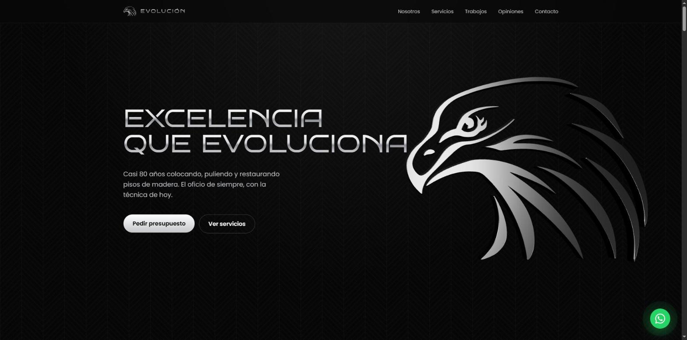
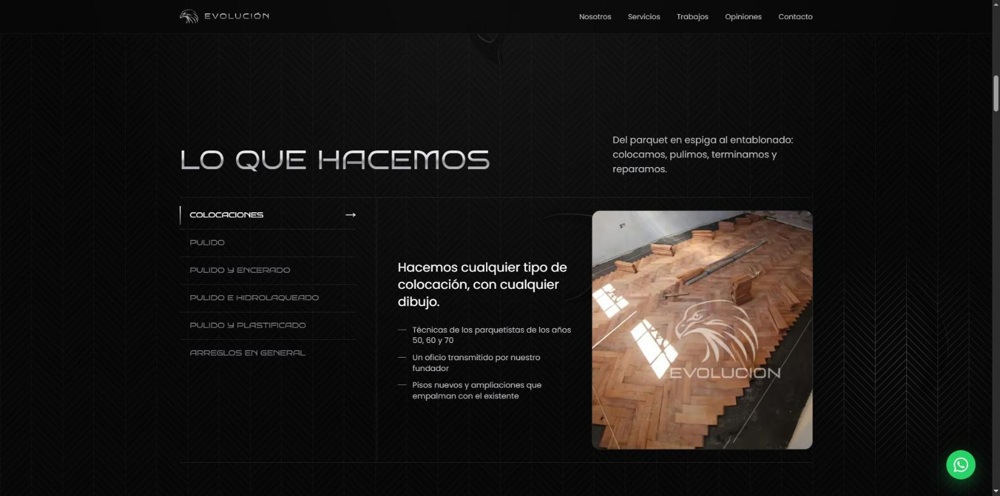
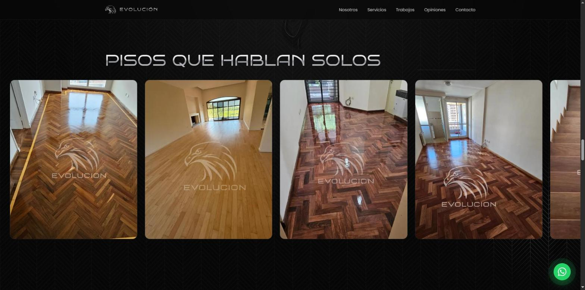

# Evolución — Sitio institucional (MVP)

**Demo:** [evolucion-web.vercel.app](https://evolucion-web.vercel.app/)

Sitio web desarrollado como propuesta comercial para una empresa de pisos de madera de Córdoba con casi 80 años de trayectoria: colocación, pulido, hidrolaqueado y restauración de parquet.

> El código es privado. Este repositorio documenta el proyecto.

## ✨ Secciones

- **Inicio** con la propuesta de valor y llamado a pedir presupuesto.
- **Servicios** en pestañas: colocaciones, pulido, encerado, hidrolaqueado, plastificado y arreglos.
- **Galería de trabajos** en carrusel.
- **Opiniones** de clientes y **contacto**.
- **Botón flotante de WhatsApp**.
- Diseño responsive.

## 🛠️ Stack

Next.js · TypeScript · Tailwind CSS · Vercel
